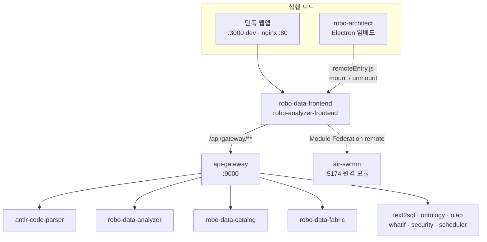
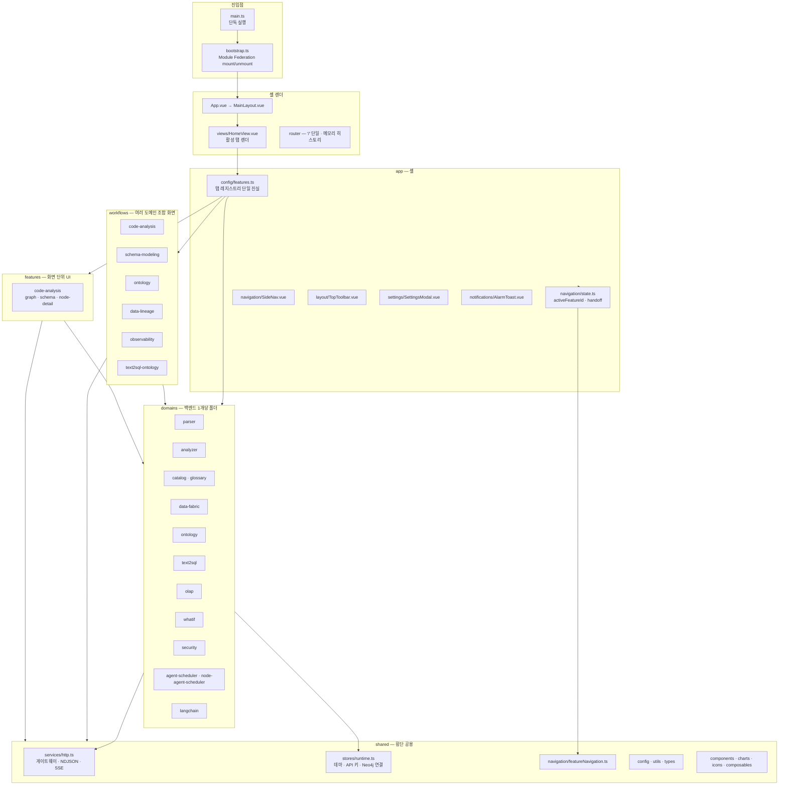
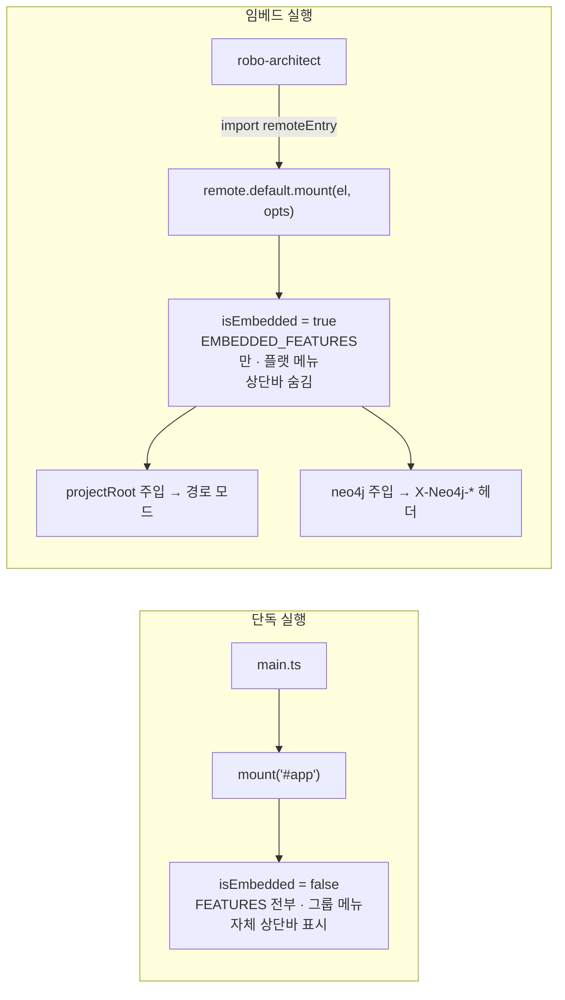
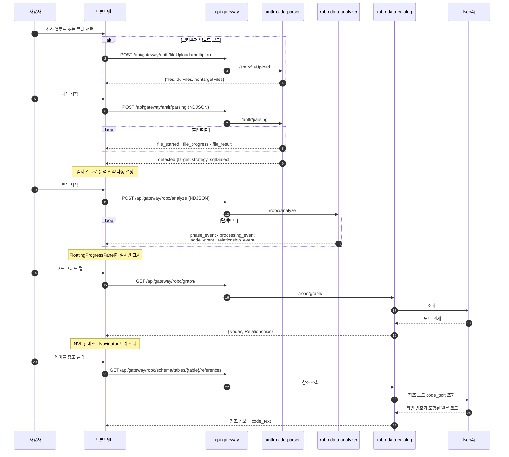
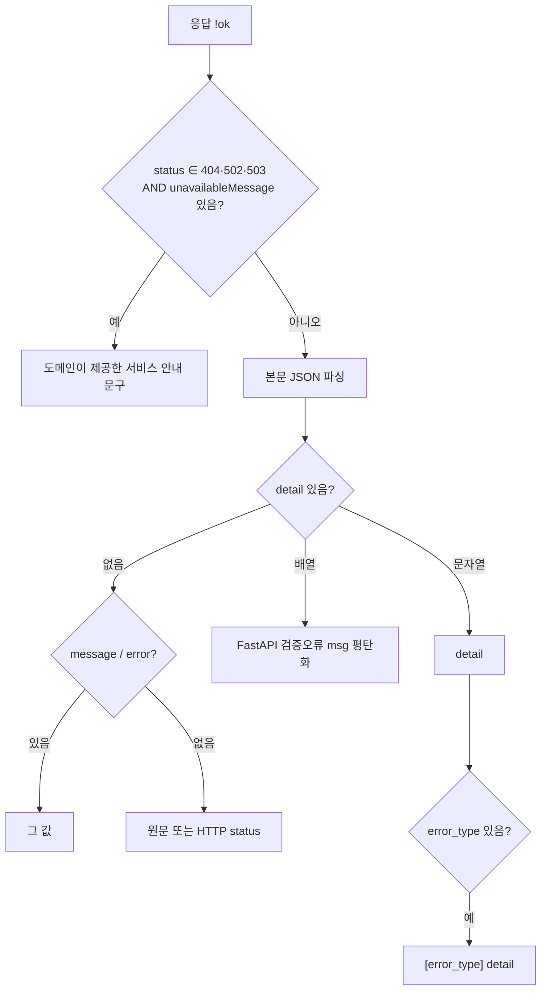
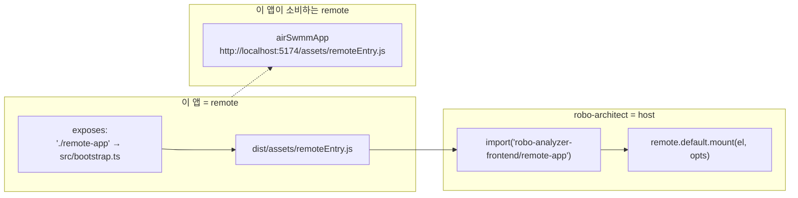

# ROBO Data Frontend

레거시 코드와 데이터베이스를 **분석해 그래프로 시각화**하는 Vue 3 단일 페이지 애플리케이션
입니다. 단독 웹앱으로 동작하고, 동시에 데스크톱 호스트(`robo-architect`, Electron)에
**Module Federation 리모트**로 끼워져 한 앱처럼 동작합니다.

백엔드 여러 개(파서·분석기·카탈로그·데이터패브릭 등) 위에 얹힌 통합 셸이며, 모든 백엔드 호출은
단일 입구인 API Gateway를 거칩니다.

---

## 목차

1. [무엇을 하는 앱인가](#1-무엇을-하는-앱인가)
2. [시스템 안에서의 위치](#2-시스템-안에서의-위치)
3. [설계 원칙](#3-설계-원칙)
4. [아키텍처](#4-아키텍처)
5. [실행 모드](#5-실행-모드)
6. [핵심 워크플로우](#6-핵심-워크플로우)
7. [기능 레지스트리](#7-기능-레지스트리)
8. [HTTP·스트림 계층](#8-http스트림-계층)
9. [상태 관리](#9-상태-관리)
10. [도메인 계층](#10-도메인-계층)
11. [워크플로우·피처 계층](#11-워크플로우피처-계층)
12. [프로젝트 구조](#12-프로젝트-구조)
13. [기술 스택](#13-기술-스택)
14. [실행](#14-실행)
15. [빌드와 배포](#15-빌드와-배포)
16. [테스트](#16-테스트)
17. [기능 추가](#17-기능-추가)
18. [문제 해결](#18-문제-해결)

---

## 1. 무엇을 하는 앱인가

| 영역 | 화면 |
|---|---|
| **코드 분석** | 소스 업로드(드래그 앤 드롭)·로컬 폴더 경로 선택, 파싱·분석 실행과 실시간 진행 표시 |
| **코드 그래프** | Neo4j 지식 그래프의 대화형 시각화 — 보기 모드 전환, Navigator 트리, 노드 상세 패널, 스타일·필터 |
| **데이터 스키마** | 테이블·컬럼 스키마 캔버스, 관계 편집, 테이블 참조 코드 추적 |
| **데이터 소스** | 대상 DB 연결 등록·검증·삭제, 테이블 탐색 |
| **자연어 질의** | 자연어 → SQL 변환, 단계별 스트리밍, 결과 테이블, 히스토리·피드백 |
| **도메인 스키마·온톨로지** | 오브젝트 타입 모델링, 다층 온톨로지 뷰어, 오브젝트 탐색기, 문서에서 스키마 추출 |
| **다이나믹 레이어** | What-If 시뮬레이터, 데이터 품질, 사고 관리, 알림, 이벤트 감지, 감시 에이전트 |
| **기준관리** | 용어 관리(글로서리), 영업일 캘린더 |
| **분석·도구** | 데이터 리니지, OLAP 분석, 보안관리자 |

여러 백엔드 위의 통합 셸이므로 화면마다 연동 성숙도가 다릅니다. **데스크톱 임베드에 노출되는
것은 코드 분석 핵심 4개**(코드 · 데이터 소스 · 코드 그래프 · 데이터 스키마)뿐입니다.

---

## 2. 시스템 안에서의 위치



| 상대 | 관계 |
|---|---|
| `api-gateway` | **모든** 백엔드 호출의 단일 입구. 개별 서비스 포트에 직접 접근하지 않습니다 |
| `antlr-code-parser` · `robo-data-analyzer` · `robo-data-catalog` · `robo-data-fabric` | 게이트웨이 경유로 호출 |
| `robo-architect` | 이 앱을 리모트 `robo-analyzer-frontend`로 로드해 캔버스의 탭에 끼워 넣습니다 |
| `air-swmm` | 이 앱이 **host가 되어** 소비하는 또 다른 원격 모듈 (`http://localhost:5174/assets/remoteEntry.js`) |

이 앱은 Module Federation의 **remote이면서 동시에 host**입니다.

---

## 3. 설계 원칙

**① 탭 레지스트리 단일 진실**
사이드 메뉴와 탭 렌더가 모두 `src/app/config/features.ts`의 `FEATURES` 배열 한 곳에서
파생됩니다. 기능 추가·삭제는 그 배열 한 줄입니다.

**② URL이 아니라 탭으로 전환**
라우터는 `/` 하나만 갖고 **메모리 히스토리**를 씁니다. 임베드 환경에서 브라우저 URL은 호스트의
것이므로 이 앱이 건드리면 안 됩니다. 화면 전환은 `activeFeatureId`가 담당합니다.

**③ 풀버전·임베드는 하드코딩 두 벌이 아니라 런타임 스위치 하나**
`isEmbedded`를 `provide/inject`로 내려주고, 임베드에서는 `embeddable=true`인 기능만 플랫 메뉴로
보여줍니다.

**④ 도메인 = 백엔드 1개**
`src/domains/<name>/`은 백엔드 하나에 대응하고 `api / application / state / ui / model` 하위
구조를 갖습니다. 여러 도메인을 조합하는 화면은 `src/workflows/<flow>/`입니다.

**⑤ 오류 문맥은 도메인이 소유**
공통 HTTP 코어는 URL로 서비스명을 추론하지 않습니다. 각 도메인이 `createHttpClient`에 자기
`serviceName`과 `unavailableMessage`를 명시적으로 넘깁니다.

**⑥ 지연 로딩**
각 기능 컴포넌트는 `defineAsyncComponent`로 감싸져 **활성 탭만 청크를 받습니다.** 임베드
3~4탭에는 나머지 도메인 코드가 실리지 않습니다.

**⑦ 스트림은 한 줄이 깨져도 계속**
NDJSON 파싱 실패는 그 줄만 건너뛰고 기록합니다. `error` 이벤트는 데이터성 이벤트이지 스트림
종결이 아닙니다 — 종결은 HTTP done 또는 `complete`입니다.

---

## 4. 아키텍처

### 4.1 계층 구조



### 4.2 폴더별 책임

| 폴더 | 책임 |
|---|---|
| `src/app/` | 애플리케이션 셸 — 탭 레지스트리, 사이드 네비게이션, 상단 툴바, 설정 모달, 알림 토스트 |
| `src/domains/<name>/` | 백엔드 **하나**에 대응. `api/`(엔드포인트) · `application/`(유스케이스) · `state/`(Pinia) · `model/`(타입·투영) · `ui/`(컴포넌트) |
| `src/workflows/<flow>/` | 여러 도메인을 조합하는 화면. 같은 하위 구조 + `composables/` |
| `src/features/<name>/` | 화면 단위 UI 조립 (현재 `code-analysis` — 코드 그래프 캔버스·스키마 탭·노드 상세) |
| `src/shared/` | 횡단 공용 — HTTP 코어, 런타임 스토어, 네비게이션 포트, 아이콘·차트·컴포넌트·컴포저블·유틸·타입 |
| `src/layouts/` · `src/views/` | `MainLayout` 하나와 `HomeView` 하나 |
| `src/router/` | `/` 단일 라우트, 메모리 히스토리 |
| `src/styles/` · `src/assets/` | SCSS와 정적 자산 |

---

## 5. 실행 모드



`bootstrap.ts`의 `mount(el, opts)`가 두 모드의 **공통 진입 로직**입니다. `main.ts`는 그것을
`#app`에 부르는 세 줄짜리 래퍼일 뿐입니다.

### `mount(el, opts)` 옵션

| 옵션 | 타입 | 효과 |
|---|---|---|
| `embedded` | `boolean` | `provide('isEmbedded')` — `MainLayout`이 자체 상단바 표시 여부를 결정하고, 메뉴가 `EMBEDDED_FEATURES`로 축소됩니다 |
| `projectRoot` | `string` | Electron이 고른 로컬 폴더. 주면 **경로 모드**(업로드 없이 그 폴더를 직접 분석), 없으면 브라우저 업로드 모드 |
| `neo4j` | `{uri, user, password, database?}` | 런타임 스토어에 주입되어 이후 모든 요청에 `X-Neo4j-*` 헤더로 실립니다. 없으면 백엔드가 서버 환경변수를 씁니다 |

반환값은 `unmount` 함수입니다. 호스트가 탭을 떠날 때 호출합니다.

### 격리 계약

| 항목 | 처리 |
|---|---|
| **Pinia** | 이 앱 전용 인스턴스를 만들어 호스트와 격리 |
| **Router** | 이 앱 전용 인스턴스 + 메모리 히스토리 → 호스트 URL 미간섭 |
| **Vue · Pinia 런타임** | Module Federation `shared: { vue: singleton, pinia: singleton }` — 호스트와 **같은 인스턴스**를 공유해 반응성·`provide/inject`가 깨지지 않음 |

---

## 6. 핵심 워크플로우

### 6.1 코드 분석 전 과정



### 6.2 진행 제어

분석 중 일시정지·재개·중단은 `POST /api/gateway/robo/analyze/control`로 보냅니다. 응답은
`{success, action, status: {isPaused, isStopped, ...}}`입니다.

---

## 7. 기능 레지스트리

`src/app/config/features.ts`가 메뉴와 탭의 단일 진실입니다.

### 그룹

| 그룹 id | 라벨 | 비고 |
|---|---|---|
| `physical` | 피지컬 레이어 | 첫 진입 시 펼침 |
| `domain` | 도메인 레이어 | |
| `dynamic` | 다이나믹 레이어 | |
| `standard` | 기준관리 | 앞에 구분선 |
| `bottom` | (헤더 없음) | 분석·도구 — 플랫 렌더 |

### 기능 목록

| id | 라벨 | 그룹 | 임베드 | 구현 위치 |
|---|---|---|:---:|---|
| `upload` | 코드 | physical | ✅ | `workflows/code-analysis/upload` → `UploadTab` |
| `datasources` | 데이터 소스 | physical | ✅ | `domains/data-fabric` → `DataSourcesTab` |
| `graph` | 코드 그래프 | physical | ✅ | `features/code-analysis/graph` → `GraphTab` |
| `schema` | 데이터 스키마 | physical | ✅ | `features/code-analysis/schema` → `SchemaTab` |
| `text2sql` | 자연어 질의 | physical | | `workflows/text2sql-ontology` → `Text2SqlWorkspace` |
| `security-guard` | 보안관리자 | physical | | `domains/security` → `SecurityGuardTab` |
| `schema-modeling` | 도메인 스키마 | domain | | `workflows/ontology` → `ObjectTypeModeler` |
| `multi-layer-ontology` | 온톨로지 관리 | domain | | `workflows/ontology` → `MultiLayerOntologyViewer` |
| `object-explorer` | 오브젝트 탐색기 | domain | | `domains/ontology/ui/explorer` → `ObjectExplorerTab` |
| `ontology-viewer` | 온톨로지 뷰어 | domain | | `domains/ontology/ui/modeling` → `OntologyViewerRemote` |
| `domain-text2sql` | 자연어 질의 | domain | | `Text2SqlWorkspace` (`domainLayerMode: true`) |
| `ontology` | 문서에서 스키마 추출 | domain | | `workflows/ontology` → `OntologyTab` (**메뉴 숨김**) |
| `whatif` | What-If 시뮬레이터 | dynamic | | `domains/whatif` → `WhatIfSimulator` |
| `data-quality` | 데이터 품질 | dynamic | | `workflows/observability` → `DataQuality` |
| `incident-manager` | 사고 관리자 | dynamic | | `workflows/observability` → `IncidentManager` |
| `alerts` | 알림들 | dynamic | | `workflows/observability` → `AlertsPage` |
| `event-detection` | 이벤트 감지 | dynamic | | `workflows/observability` → `EventDetection` |
| `watch-agent` | 감시 에이전트 | dynamic | | `workflows/observability` → `WatchAgent` |
| `glossary` | 용어 관리 | standard | | `domains/catalog/glossary` → `GlossaryTab` |
| `business-calendar` | 영업일 캘린더 | standard | | `domains/catalog/glossary` → `BusinessDayCalendar` |
| `lineage` | 데이터 리니지 | bottom | | `workflows/data-lineage` → `LineageTab` |
| `olap` | OLAP 분석 | bottom | | `domains/olap` → `OlapTab` |

`hidden: true`인 기능은 메뉴에 나타나지 않지만 feature id로 직접 이동하는 계약은 유지됩니다.

### `FeatureDef` 필드

| 필드 | 의미 |
|---|---|
| `id` | `activeFeatureId` 값 |
| `label` · `icon` | 메뉴 표시 |
| `group` | 소속 그룹 |
| `component` | `defineAsyncComponent` — 활성 시에만 로드 |
| `props` | 컴포넌트에 넘길 고정 props |
| `embeddable` | 임베드 노출 여부 |
| `hidden` | 메뉴 숨김 |

---

## 8. HTTP·스트림 계층

`src/shared/services/http.ts`가 모든 도메인 API의 공통 코어입니다.

### 베이스 URL

```ts
export const API_GATEWAY_URL = import.meta.env.VITE_API_GATEWAY_URL ?? '/api/gateway'
```

도메인별 베이스는 여기서 파생됩니다.

| 도메인 | 베이스 |
|---|---|
| `analyzer` | `${API_GATEWAY_URL}/robo` |
| `catalog` | `${API_GATEWAY_URL}/robo` |
| `parser` | `${API_GATEWAY_URL}/antlr` |
| `data-fabric` · `text2sql` · `ontology` 등 | 각 도메인의 `api/baseUrl.ts` |

### 제공 함수

| 함수 | 용도 |
|---|---|
| `postJson<T>` | JSON POST |
| `postFormData<T>` | 파일 업로드. 브라우저가 `Content-Type`을 정하도록 헤더에서 제거 |
| `streamFetch` | **NDJSON** 스트림 POST |
| `streamSseFetch<T>` | **SSE** 스트림 GET (`event:` / `data:` 라인 파싱) |
| `handleHttpError` | 공통 오류 변환 (중복 정의 금지) |
| `createHttpClient(context)` | 도메인이 자기 오류 문맥을 소유한 채 공통 transport를 재사용하는 경계 |

### 오류 처리



서비스별 안내 문구는 **URL로 추론하지 않습니다** — 소유 도메인이 명시적으로 제공합니다.

### NDJSON 스트림 규칙

| 규칙 | 내용 |
|---|---|
| 줄 단위 파싱 | 개행으로 분할, 마지막 불완전 조각은 버퍼에 유지 |
| **손상 줄 복원** | JSON 파싱 실패는 그 줄만 경고 기록 후 건너뜁니다. 스트림 전체를 죽이지 않습니다 |
| **`error`는 종결이 아님** | `error`는 표시용 데이터 이벤트입니다. 종결로 오인하면 같은 청크의 뒤 라인(node/relationship 등)이 유실됩니다 |
| 종결 | HTTP `done` 또는 `type: 'complete'` |
| 마지막 버퍼 | 스트림 종료 후 남은 버퍼도 한 번 더 파싱 |

### dev 프록시의 스트리밍 보존

Vite dev 서버는 `/api/gateway`를 게이트웨이(`:9000`)로 프록시하면서, URL에
`/stream` · `/react` · `/analyze` · `/parsing` · `/pipeline` · `/search` 중 하나가 포함되면
스트리밍 요청으로 판정해 다음을 적용합니다.

- 요청: `Accept: application/x-ndjson, text/event-stream`, `Cache-Control: no-cache`,
  `Connection: keep-alive`
- 응답: `cache-control: no-cache, no-transform`, `x-accel-buffering: no`,
  `content-length` 제거

`/air-swmm`도 같은 게이트웨이로 프록시됩니다.

---

## 9. 상태 관리

Pinia 스토어는 소유 범위가 명확히 나뉩니다.

| 스토어 | 위치 | 소유 |
|---|---|---|
| `app-navigation` | `app/navigation/state.ts` | 활성 기능 id와 **일회성 handoff 페이로드** |
| `runtime` | `shared/stores/runtime.ts` | 테마, LLM API 키·공급자, Neo4j 연결 override, 공통 요청 헤더 |
| 도메인 스토어 | `domains/*/state/`, `workflows/*/state/` | 각 도메인·워크플로의 화면 상태 |

### 네비게이션 handoff

탭 사이에 값을 넘길 때 전역 상태를 오염시키지 않도록 **일회성 페이로드**를 씁니다.

| API | 동작 |
|---|---|
| `openFeature(id, payload?)` | 페이로드를 저장하고 그 탭으로 전환 |
| `peekHandoff(id)` | 소비하지 않고 조회 |
| `consumeHandoff(id)` | 조회 후 제거 |
| `resetNavigation()` | handoff 전부 비우고 기본 탭(`upload`)으로 |

도메인 코드는 스토어를 직접 import하지 않고 `FEATURE_NAVIGATION_KEY`로 주입된
`FeatureNavigationPort`(`activeFeatureId` / `open` / `peek` / `consume`)를 통해 접근합니다.

### 런타임 헤더

`runtime` 스토어의 `getHeaders()`가 모든 백엔드 요청에 실을 헤더를 만듭니다.

| 헤더 | 조건 |
|---|---|
| `Accept-Language: ko` | 항상 |
| `X-LLM-Api-Key` | 사용자가 설정에서 API 키를 입력했을 때 |
| `X-Neo4j-Uri` · `X-Neo4j-User` · `X-Neo4j-Password` | Electron 호스트가 연결을 주입했을 때 |
| `X-Neo4j-Database` | 위에 더해 `database`가 지정됐을 때 |

테마와 API 키·공급자는 `localStorage`에 보존됩니다(`robo-analyzer-theme`,
`robo-analyzer-api-key`, `robo-analyzer-api-provider`). 테마 전환 시 250ms 동안
`theme-transitioning` 클래스가 붙습니다.

---

## 10. 도메인 계층

| 도메인 | 대응 백엔드 | 주요 내용 |
|---|---|---|
| `parser` | antlr-code-parser | 업로드·파싱 스트림 클라이언트, 업로드 경로 정규화 |
| `analyzer` | robo-data-analyzer | 분석 스트림, 시맨틱 검색, 진행 제어, 원문 소스 조회 |
| `catalog` | robo-data-catalog | 그래프·스키마·리니지 조회, 스키마 계약 타입 |
| `catalog/glossary` | robo-data-catalog | 용어 관리 — 목록·모달·대량 업로드 3단계 위저드·영업일 캘린더 |
| `data-fabric` | robo-data-fabric | 데이터소스 등록 다이얼로그, 커넥터 카탈로그, 상세 패널, 삭제 |
| `ontology` | ontology/domain-layer | 스키마 추출 위저드, 오브젝트 탐색기, 모델링(BPMN·DMN 편집기), What-If 패널 |
| `text2sql` | text2sql | 질의 입력, ReAct 진행, 결과 테이블, 히스토리, 피드백, SQL diff |
| `olap` | olap | 큐브 디자이너, 피벗 분석, ETL 스크립트 수명주기 |
| `whatif` | whatif | 인과 발견, 시나리오 입력, 검증 비교, 설명가능성 |
| `security` | security | 사용자·역할·테이블 권한·보안 정책·감사 로그 |
| `agent-scheduler` · `node-agent-scheduler` | agent-scheduler | 에이전트 스케줄 API 클라이언트 |
| `langchain` | robo-architect(`/langchain`) | LangChain 계열 API 클라이언트 |

각 도메인의 표준 하위 구조:

```
domains/<name>/
├── api/            baseUrl · http(도메인 오류 문맥) · client · contracts
├── application/    유스케이스·정책 (프레임워크 비의존 로직)
├── composables/    Vue 컴포저블
├── model/          타입·투영(projection)
├── state/          Pinia 스토어
├── ui/             컴포넌트
└── index.ts        공개 표면
```

---

## 11. 워크플로우·피처 계층

### `src/workflows/`

여러 도메인을 조합하는 화면입니다.

| 워크플로 | 조합 대상 | 내용 |
|---|---|---|
| `code-analysis` | parser + analyzer | 업로드 트리·드롭존·스코프 브라우저, 분석 진행 패널, analyzer/navigator/semanticSearch 스토어 |
| `schema-modeling` | catalog + analyzer | 스키마 캔버스(테이블 노드·관계 편집·카디널리티), 테이블 상세·데이터 패널, 원문 코드 패널 |
| `ontology` | ontology + data-fabric + catalog | 오브젝트 타입 모델러, 다층 온톨로지 뷰어, 캔버스 편집·이력·필터·레이아웃, 데이터소스 매핑 |
| `data-lineage` | catalog | 리니지 그래프·상세 패널, 분석 게이트웨이 |
| `observability` | agent-scheduler 계열 | 데이터 품질, 사고 관리, 알림, 이벤트 감지, 감시 에이전트, 워크플로 노드 |
| `text2sql-ontology` | text2sql + ontology | 질의 워크스페이스, SQL 결과에서 인스턴스 생성 |

### `src/features/code-analysis/`

코드 그래프 화면의 UI 조립 계층입니다.

| 파일 | 역할 |
|---|---|
| `graph.ts` · `graphCanvas.ts` · `graphViewModel.ts` | 그래프 데이터 → 캔버스 뷰모델 |
| `areaGraph.ts` | 영역(area) 보기 모드 |
| `navigation.ts` | Navigator 트리 탐색 |
| `nodeDetailProjection.ts` · `panelGraphProjection.ts` | 노드 상세·패널 투영 |
| `components/graph/NvlGraph.vue` | `@neo4j-nvl` 기반 캔버스 |
| `components/graph/NavigatorPanel.vue` · `NavigatorTreeNode.vue` | 트리 패널 |
| `components/graph/GraphStylePanel.vue` · `useGraphTypeFilter.ts` · `useGroupHulls.ts` | 스타일·필터·군집 hull |
| `components/graph/node-detail/*` | 노드 종류별 상세 카드 — File · Module · Package · Function · Variable · Datatype · Table · Column · SqlStatement · Attached · NonCode · Fallback. `templateRouter.ts`가 노드 타입에 맞는 카드를 선택 |

---

## 12. 프로젝트 구조

```
robo-data-frontend/
├── index.html
├── vite.config.ts                Module Federation · dev 프록시 · preview 포트
├── package.json                  scripts · 의존성
├── tsconfig.json · tsconfig.node.json · tsconfig.panel-projection.json
├── nginx.conf                    컨테이너 배포용 SPA 라우팅 + 게이트웨이 프록시
├── Dockerfile                    node:20-alpine 빌드 → nginx:alpine 서빙
├── scripts/
│   ├── test-node-label-role-lens.mjs        prebuild 검증
│   └── test-panel-relationship-projection.mjs
├── tests/external-graph-contract.mjs
├── public/
└── src/
    ├── main.ts                   단독 실행 진입점 (bootstrap.mount 호출)
    ├── bootstrap.ts              Module Federation 진입점 — mount / unmount
    ├── App.vue                   MainLayout 렌더
    ├── app/
    │   ├── config/features.ts    ★ 탭 레지스트리 단일 진실
    │   ├── navigation/state.ts   activeFeatureId · handoff 스토어
    │   ├── navigation/SideNav.vue
    │   ├── layout/TopToolbar.vue
    │   ├── notifications/        AlarmToast · alarmGateway
    │   └── settings/             SettingsModal · SettingsActionDialog · settingsDraft
    ├── layouts/MainLayout.vue
    ├── views/HomeView.vue        활성 탭 렌더
    ├── router/index.ts           '/' 단일 라우트 · 메모리 히스토리
    ├── domains/                  parser · analyzer · catalog(+glossary) · data-fabric
    │                             ontology · text2sql · olap · whatif · security
    │                             agent-scheduler · node-agent-scheduler · langchain
    ├── workflows/                code-analysis · schema-modeling · ontology
    │                             data-lineage · observability · text2sql-ontology
    ├── features/code-analysis/   코드 그래프 캔버스 · 스키마 탭 · 노드 상세 카드
    ├── shared/
    │   ├── services/http.ts      ★ 게이트웨이 · NDJSON · SSE · 오류 변환
    │   ├── stores/runtime.ts     테마 · API 키 · Neo4j 연결 · 공통 헤더
    │   ├── navigation/           FeatureNavigationPort
    │   ├── browser/              desktopFileSystem · externalHttpUrl
    │   ├── components/           ActionDialog · CodeViewer · TextViewer · DataConfirmModal
    │   ├── charts/               Bar · Line · Pie · Map · ChartRenderer
    │   ├── composables/          useDrag · useResize · useResizablePanel
    │   │                         useManagedTimeouts · useLatestTaskScope
    │   │                         useDialogFocusLifecycle
    │   ├── config/               appSettings · graphStyles · storageKeys
    │   ├── icons/                51개 SVG 아이콘 컴포넌트 + index.ts
    │   ├── types/ · utils/       그래프 표시·식별·분류, 레이아웃(elk), 로거 등
    ├── styles/ · assets/
```

---

## 13. 기술 스택

| 영역 | 사용 |
|---|---|
| 프레임워크 | Vue 3.4 (Composition API) · TypeScript 5.3 |
| 빌드 | Vite 5 · vue-tsc · sass |
| 상태·라우팅 | Pinia 2 · Vue Router 4 (메모리 히스토리) |
| 모듈 연합 | `@originjs/vite-plugin-federation` 1.4 |
| 코드 그래프 | `@neo4j-nvl/base` · `@neo4j-nvl/interaction-handlers` |
| 다이어그램 | `@vue-flow/core` (+background·controls·minimap) · cytoscape (+edgehandles) · elkjs |
| 프로세스·규칙 | bpmn-js 18 · dmn-js 17 (drd · decision-table · literal-expression) |
| 차트 | echarts 6 + vue-echarts · chart.js 4 + vue-chartjs · d3-sankey · mermaid 10 |
| 에디터 | monaco-editor 0.45 |

---

## 14. 실행

### 개발 서버

```bash
npm install
npm run dev
```

`http://localhost:3000`에서 열립니다(`127.0.0.1`에 바인딩 — 게이트웨이가 IPv4로 접근할 수 있게).
`/api/gateway/**` 요청은 Vite 프록시가 게이트웨이(`localhost:9000`)로 전달합니다.

**게이트웨이가 떠 있어야 합니다.** 여러 서비스를 함께 띄울 때는 각 저장소를 손으로 켜지 말고
워크스페이스 실행기를 씁니다.

```cmd
cd robo-workspace
robo.cmd up analyzer
```

### npm 스크립트

| 스크립트 | 내용 |
|---|---|
| `dev` | Vite 개발 서버 (:3000) |
| `build` | `vue-tsc --noEmit` 타입체크 후 프로덕션 빌드. **prebuild로 `test-node-label-role-lens.mjs` 실행** |
| `build:docker` | 타입체크 없이 빌드 (prebuild 검증은 동일하게 실행) |
| `preview` | 빌드 결과 서빙 (:5001, `127.0.0.1`, CORS 허용) |
| `type-check` | `vue-tsc --noEmit` |
| `test:node-role-lens` | 노드 라벨·역할 렌즈 검증 |
| `test:panel-projection` | 패널 관계 투영 검증 |
| `type-check:panel-projection` | 패널 투영 전용 tsconfig 타입체크 |

### 환경 변수

| 변수 | 기본 | 설명 |
|---|---|---|
| `VITE_API_GATEWAY_URL` | `/api/gateway` | 게이트웨이 베이스. 비우면 상대경로 → Vite 프록시/nginx 프록시가 처리 |
| `ANALYZER_BASE` | `/` | 빌드 시 Vite `base`. Electron co-locate 배포에서 `/analyzer/`를 주입해 청크가 `app://app/analyzer/assets/`로 해석되게 합니다 |

---

## 15. 빌드와 배포

### 15.1 Module Federation



| 항목 | 값 |
|---|---|
| 리모트 이름 | `robo-analyzer-frontend` |
| 노출 모듈 | `./remote-app` → `src/bootstrap.ts` |
| 산출 파일 | `remoteEntry.js` |
| 공유 싱글톤 | `vue`, `pinia` |
| 소비하는 리모트 | `airSwmmApp` |

**Module Federation 리모트는 dev 서버가 아니라 빌드 결과를 서빙해야 동작합니다.**
그래서 `preview` 포트가 `5001`로 고정되어 있고 CORS가 켜져 있습니다.

```bash
npm run build && npm run preview   # 호스트가 http://127.0.0.1:5001/assets/remoteEntry.js 를 로드
```

워크스페이스의 `architect-web` 프로필은 이 앱을 `--port 15001 --strictPort`로 띄우고 호스트에
`ANALYZER_REMOTE_URL=http://127.0.0.1:15001/assets/remoteEntry.js`를 주입합니다 — 그 경로로
실행할 때는 `5001`이 아니라 `15001`이 리모트 주소입니다.

### 15.2 빌드 옵션

| 옵션 | 값 | 이유 |
|---|---|---|
| `base` | `ANALYZER_BASE || '/'` | Electron co-locate 배포 경로 |
| `build.target` | `esnext` | |
| `build.minify` | `false` | |
| `build.modulePreload` | `false` | |
| `build.cssCodeSplit` | `false` | |
| `optimizeDeps.include` | `monaco-editor` | |

### 15.3 컨테이너 배포

멀티스테이지 — `node:20-alpine`에서 `npm ci` 후 `npm run build:docker`
(`NODE_OPTIONS=--max-old-space-size=8192`), 산출물을 `nginx:alpine`의
`/usr/share/nginx/html`로 복사하고 `80`을 노출합니다. 30초 간격 헬스체크가 붙습니다.

`nginx.conf`가 하는 일:

| 위치 | 동작 |
|---|---|
| `/` | SPA 라우팅 — `try_files $uri $uri/ /index.html` |
| `/api/gateway/` | `robo-api-gateway:9000`으로 프록시. `client_max_body_size 1024m`, read/send 타임아웃 600초, connect 75초, WebSocket 업그레이드 헤더 |
| `/api/datasources` | 게이트웨이로 프록시 (폴백 경로, 타임아웃 300초) |
| 정적 자산 | `js/css/이미지/폰트` 1년 캐시 + `immutable` |
| gzip | text/css/json/javascript/xml |

### 15.4 데스크톱 임베드

Electron이 빌드본을 `app://`로 co-locate 서빙합니다. 호스트가 마운트 시 임베드 여부, 로컬 폴더
경로(경로 모드), Neo4j 연결을 주입합니다.

---

## 16. 테스트

브라우저 테스트 러너 없이 **Node 스크립트로 계약을 고정**합니다.

| 스크립트 | 검증 | 실행 시점 |
|---|---|---|
| `scripts/test-node-label-role-lens.mjs` | 노드 라벨·역할 렌즈 투영 | **`build`/`build:docker`의 prebuild로 자동 실행** — 실패하면 빌드가 진행되지 않습니다 |
| `scripts/test-panel-relationship-projection.mjs` | 패널 관계 투영 | `npm run test:panel-projection` |
| `tests/external-graph-contract.mjs` | 외부 그래프 계약 | 직접 실행 |

타입 안전성은 `npm run type-check`(`vue-tsc --noEmit`)와 패널 투영 전용
`npm run type-check:panel-projection`이 담당합니다.

---

## 17. 기능 추가

**새 탭을 추가할 때**

1. 화면 컴포넌트를 만듭니다 — 백엔드 하나에 대응하면 `src/domains/<name>/ui/`,
   여러 도메인을 조합하면 `src/workflows/<flow>/ui/`.
2. 그 폴더의 `index.ts`에서 named export로 공개합니다.
3. `src/app/config/features.ts`의 `FEATURES` 배열에 한 줄 추가합니다.

```ts
{ id: 'my-feature', label: '내 기능', icon: IconGrid, group: 'physical',
  component: lazyNamed(() => import('@/domains/my-domain'), 'MyFeatureTab') }
```

4. 임베드에도 노출하려면 `embeddable: true`, 메뉴에서 숨기려면 `hidden: true`를 붙입니다.

`SideNav`와 `HomeView`가 자동으로 반영합니다 — 다른 파일을 고칠 필요가 없습니다.

**새 백엔드를 붙일 때**

1. `src/domains/<name>/api/baseUrl.ts`에 `API_GATEWAY_URL` 기반 베이스를 정의합니다.
2. `api/http.ts`에서 `createHttpClient({ serviceName, unavailableMessage })`로 오류 문맥을
   소유한 클라이언트를 만듭니다.
3. `api/contracts.ts`에 요청·응답 타입, `api/client.ts`에 엔드포인트를 정의합니다.
4. 게이트웨이(`api-gateway`)에 해당 경로 라우트가 있는지 확인합니다.

**탭 사이로 값을 넘길 때** — 전역 스토어를 늘리지 말고
`FeatureNavigationPort.open(featureId, payload)` → 대상 탭에서 `consume(featureId)`를 씁니다.

---

## 18. 문제 해결

| 증상 | 원인 | 조치 |
|---|---|---|
| 모든 API가 실패 | 게이트웨이 미기동 | `robo.cmd up analyzer` 또는 게이트웨이 단독 기동. `http://localhost:9000/actuator/health` 확인 |
| 스트림이 끝난 뒤 한꺼번에 도착 | 프록시 버퍼링 | dev는 URL에 `analyze`/`parsing`/`search` 등이 포함돼야 스트리밍 헤더가 붙습니다. nginx는 `proxy_read_timeout` 확인 |
| 분석 노드가 일부 유실 | 스트림 `error`를 종결로 처리 | `error`는 데이터 이벤트입니다. 종결은 `complete` 또는 HTTP done |
| 콘솔에 `NDJSON 한 줄 파싱 실패` | 손상된 줄 하나 | 그 줄만 건너뛰고 계속됩니다. 반복되면 백엔드 스트림 인코딩 확인 |
| 호스트에서 임베드가 안 뜸 | dev 서버를 리모트로 물림 | 리모트는 **빌드본**이어야 합니다 — `npm run build && npm run preview`(:5001) |
| 임베드에서 반응성·inject가 깨짐 | Vue/Pinia 인스턴스가 둘 | federation `shared` 싱글톤 설정과 호스트 버전 확인 |
| 임베드에서 URL이 바뀜 | 라우터 히스토리 종류 | 메모리 히스토리여야 합니다 |
| 임베드인데 상단바가 보임 | `embedded` 옵션 미전달 | 호스트가 `mount(el, { embedded: true })`로 호출 |
| Electron에서 다른 Neo4j를 봄 | 호스트가 주입한 `X-Neo4j-*`가 우선 | 주입값과 백엔드 기본값 대조 |
| 데스크톱 빌드에서 청크 404 | `base` 불일치 | 빌드 시 `ANALYZER_BASE=/analyzer/` 주입 |
| 빌드가 prebuild에서 멈춤 | `test-node-label-role-lens.mjs` 실패 | 노드 라벨·역할 렌즈 계약 위반 — 스크립트 출력 확인 |
| 컨테이너 빌드 OOM | 번들 크기 | Dockerfile의 `NODE_OPTIONS=--max-old-space-size` 확인 |
| 대용량 업로드 413 | nginx 본문 크기 | `client_max_body_size` (현재 1024m) |
| 메뉴에 기능이 안 보임 | `hidden: true`이거나 임베드 모드 | `FEATURES` 정의와 `embeddable` 확인 |
